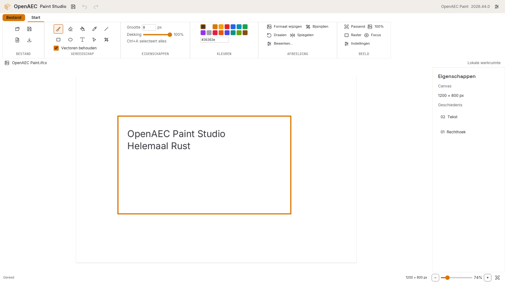
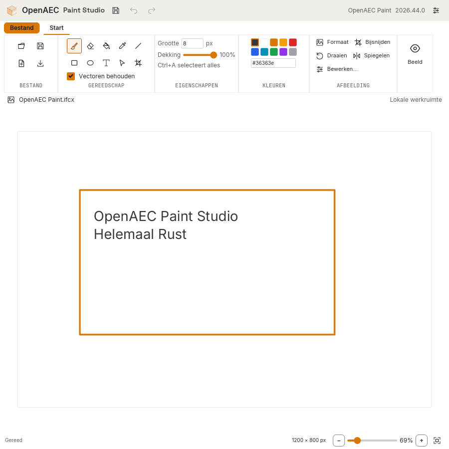
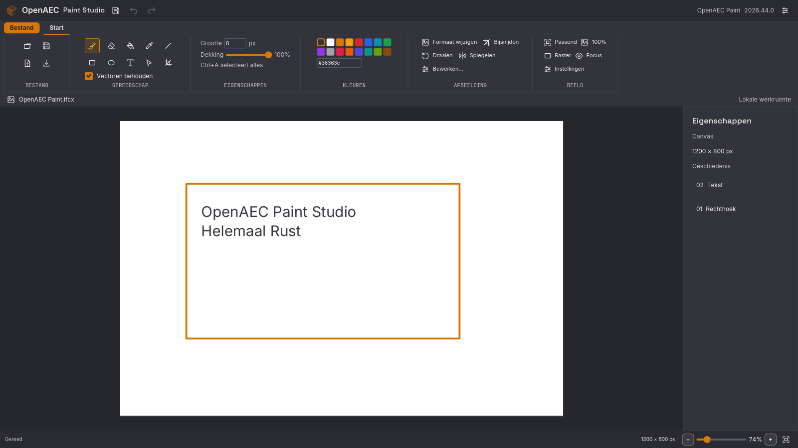

# OpenAEC Paint Studio

A simple MS Paint inspired image editor, written in **Rust**. The native desktop editor and browser preview share the same image engine and iced UI. Version **2026.44.0** uses the current OpenAEC Blueprint library.

[Download installers](https://github.com/JanAdriaan891/OpenAEC-Paint-Studio/releases/latest) · [Builds and signing](docs/RELEASING.md) · [API](docs/API.md) · [MCP](docs/MCP.md)

## Editor



- Antialiased brush, eraser, fill, picker, line, rectangle, ellipse and editable multiline text.
- Keep vector objects to select, move, resize, restyle and export them as SVG. Ctrl+A selects all objects; Escape returns to selection mode.
- Crop, resize, rotate, mirror, grayscale, invert, sepia, brightness, contrast and saturation.
- Open common images, HEIC, AVIF, PSD, JPEG XL, JPEG 2000 and supported camera RAW files. The default open dialog filters images; IFCX has its own command. [Supported formats and limits](docs/IMAGE-FORMATS.md).
- Save a raster snapshot as IFCX/IFCXB, or export PNG, JPEG, lossless WebP and SVG. No `.oapaint` format.
- Undo/redo, Ctrl+wheel zoom, middle-button pan, grid, local draft recovery and five Blueprint themes. Dutch/English interface.
- Rust REST API and MCP stdio executables use the same renderer and document model. No Node runtime is needed for the editor or services.

The ribbon automatically changes each group from expanded controls to compact controls and then a group menu. Every command stays accessible without a horizontal scrollbar, including at the supported minimum width of 560 px.





## Build and run

Use **Rust 1.98.1** and Cargo. Linux needs X11/Wayland, xkbcommon and xkbcommon-x11 development libraries; Windows uses the MSVC toolchain; macOS uses Xcode command line tools.

```sh
cargo run --release -p openaec-paint-studio
cargo test --workspace --locked
cargo build --workspace --release --locked
```

Release executables are `target/release/openaec-paint-studio`, `paint-api`, `paint-mcp` and `paint-release` (with `.exe` on Windows). An image filename can be passed to the desktop executable. Linux DEB/AppImage, Windows NSIS and universal macOS DMG builds include image Open With registration. Services are also distributed as separate native archives.

The browser runs the same Rust application compiled to WebAssembly with the software renderer. JavaScript is limited to generated Wasm bindings and the module bootstrap. Run `scripts/build-web.sh`, then `python3 -m http.server 3020 --bind 127.0.0.1 --directory web-dist`.

Browser interaction tests use Playwright as a development dependency: `pnpm install --frozen-lockfile`, `pnpm exec playwright install chromium`, then `pnpm test:web` against `PAINT_WEB_URL` (default port 49325). There is no JavaScript editor or JavaScript API server.

## API and MCP

```sh
./target/release/paint-api
./target/release/paint-mcp   # normally launched by an MCP host
```

The API listens on `127.0.0.1:47831` and creates a private `.paint-data/token`. Enter the token in the editor's API dialog to explicitly send or retrieve a document. Revision checks prevent stale edits from overwriting newer ones. API and MCP do not start automatically with the editor.

IFCX saves contain the visible **raster image**, using the OpenAEC raster extension, rather than the editable scene. Browser drafts retain editable operations in the existing IndexedDB database; native Rust drafts use the platform's application data directory. Keep an export or backup for important work. See [IFCX](docs/IFCX.md).

## Blueprint and licensing

UI and theme tokens come from [OpenAEC Blueprint](https://github.com/OpenAEC-Foundation/OpenAEC-Blueprint), revision `7a2f7cdc095e3854767af07e4e4cf07192498b8f`, with `openaec-ui 2026.44.1` vendored unchanged. New Paint code is MIT. Blueprint is LGPL-3.0, Rawler is LGPL-2.1, OpenAEC symbols/icons retain CC BY-SA 4.0, and bundled fonts retain their own licenses. Installers include dependency notices; each release includes complete corresponding source and locked dependencies for rebuilding modified components. See [third-party notices](THIRD_PARTY_NOTICES.md).
